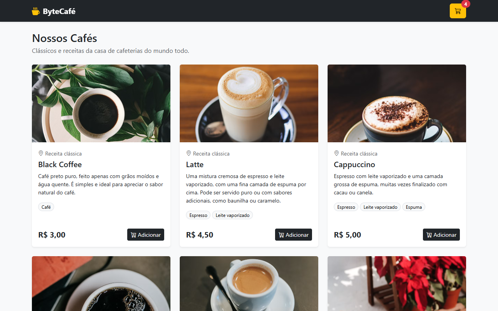
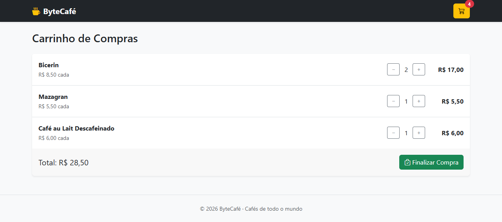
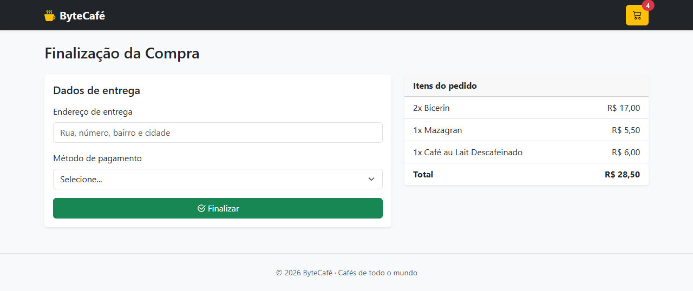

# ByteCafé

Loja virtual de cafés feita com JavaScript puro, Bootstrap e json-server.







## Como rodar

Precisa ter o [Node.js](https://nodejs.org) instalado.

```bash
npm install
npm start
```

Depois abra http://localhost:3000 no navegador.
